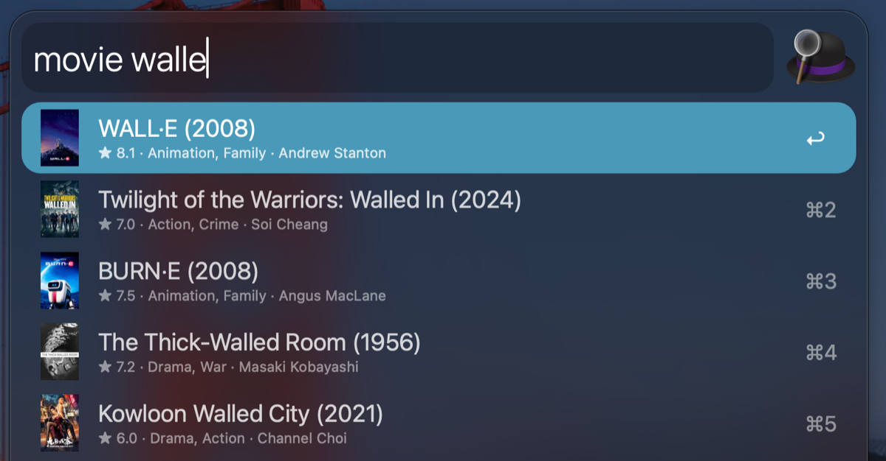
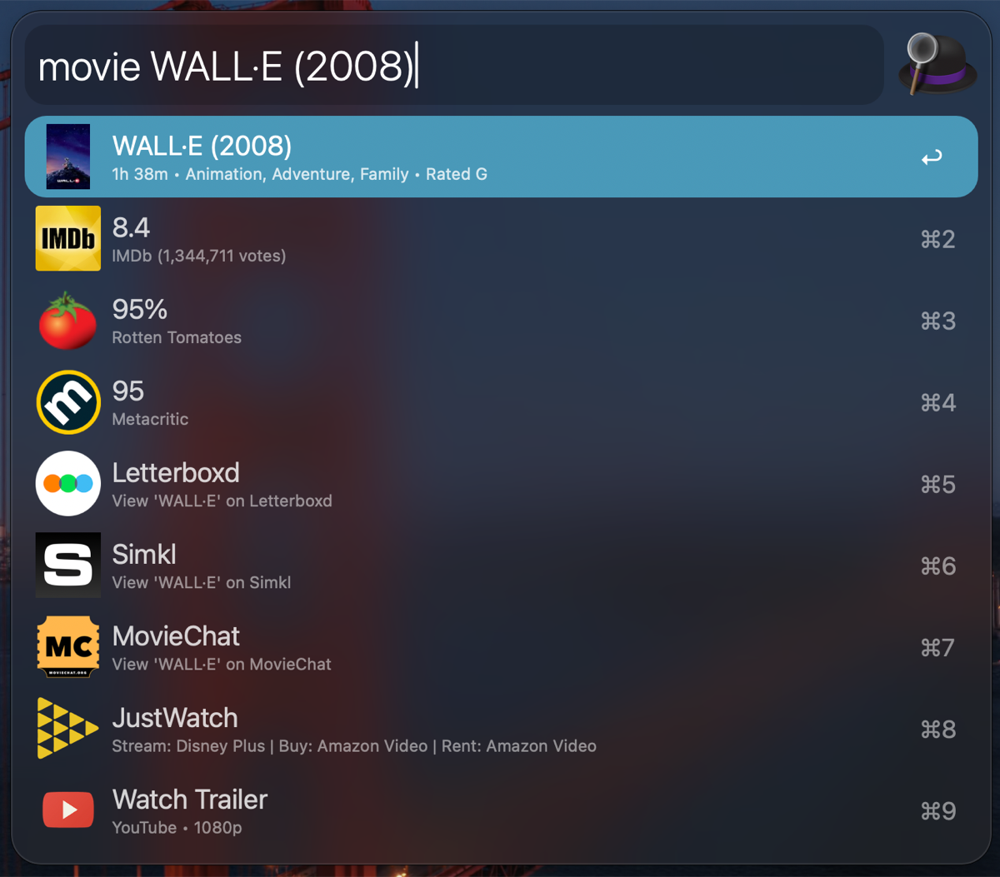
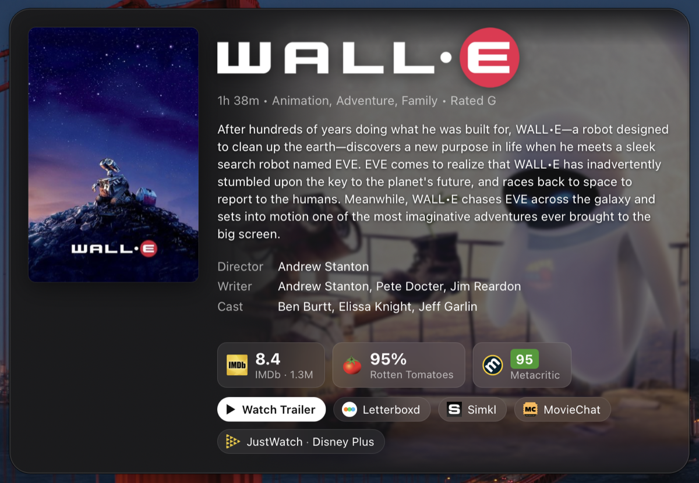

# Movie and TV Show Search (an Alfred workflow)

Search for a movie or TV show from Alfred, then get its ratings, details and links.

## Requirements

Version 3 requires **Alfred 6** (with the Powerpack). On Alfred 5, use [version 2.23.0](https://github.com/tmcknight/Movie-and-TV-Show-Search-Alfred-Workflow/releases/tag/2.23.0), the last release that supports it.

## Installation

Download and open the [latest workflow release](https://github.com/tmcknight/Movie-and-TV-Show-Search-Alfred-Workflow/releases/latest).

## Usage

### Search

Type `movie` or `tv`, then a title. Each result shows its poster, its TMDb rating and genres, and the director (movies) or number of seasons (TV shows). Directors and season counts appear once you stop typing.

Press ↩ (or ⇥) on a result to see its details.

### Details

The details list has the ratings from IMDb, Rotten Tomatoes and Metacritic, links to the title on other sites and its trailer, and the director, writers and actors.

- Press ↩ on a rating or link to open it. **Search** opens the title on every rating site at once.
- Press ⌘C to copy a row: the TMDb, IMDb or TheTVDB id, or the names of the people.

### Details window

Press ↩ on the title row (the one with the poster) to open the details window, with the poster, backdrop, overview, credits, ratings and links.

- Click a rating or a link to open it, or press ⌘1–⌘9 to open them in order.
- Hover over the poster and click the copy button to copy the poster image.
- Press ⎋, ← or ⌫ to go back to the details list.

### Trailers

Trailers open on YouTube in your browser. To play them in their own window instead (which can go full screen with ⌃⌘F), turn on **Play trailers in Alfred** in the workflow's configuration.

## Configuration

| Setting | Default | What it does |
| --- | --- | --- |
| Movie Search Keyword | `movie` | Keyword for searching movies. |
| TV Search Keyword | `tv` | Keyword for searching TV shows. |
| OMDB API Key | a shared key | The key for the IMDb, Rotten Tomatoes and Metacritic ratings. [Get your own](https://omdbapi.com/apikey.aspx) if the shared one runs out. |
| Locale | `US` | The country for certifications (e.g. PG-13) and JustWatch. |
| Search Language | `en` | The language to search and show titles in. |
| Extra Websites | all on | Show links to Letterboxd, Simkl, MovieChat and JustWatch. |
| Trailers | off | Play trailers in Alfred instead of on YouTube. |

## Credits

- The movie and TV show details come from [TMDb](https://themoviedb.org/) and the [OMDb API](https://www.omdbapi.com). This product uses the TMDb API but is not endorsed or certified by TMDb.
- Big thanks to [vitorgalvao](https://github.com/vitorgalvao) and [deanishe](https://github.com/deanishe) for their commitment to the Alfred community.
- I love [Alfred](https://alfredapp.com/)!

## Releasing

Run the **Release** workflow from the repository's Actions tab with the new version number (e.g. `3.0.1`). It sets the version in `info.plist`, tags it, builds the `.alfredworkflow` and publishes a GitHub release with notes generated from the merged pull requests. Text in the optional notes field goes above them.

## License

This workflow is released under the [MIT Licence](https://opensource.org/licenses/MIT).
